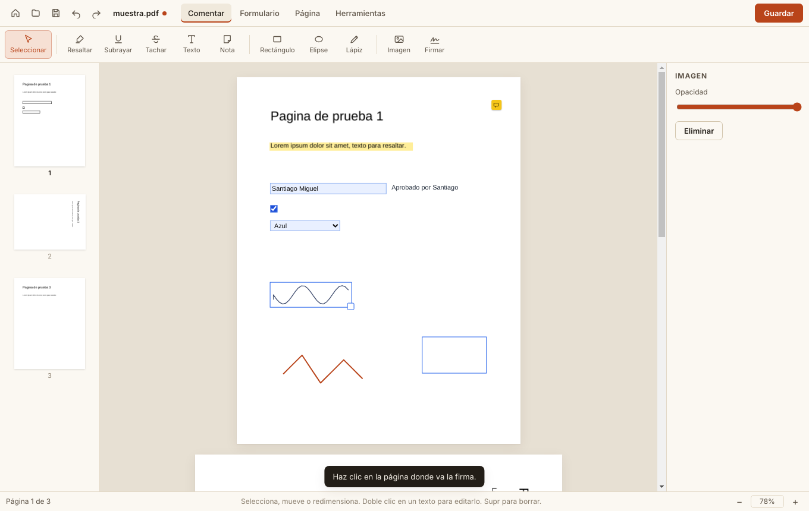

# PapelPDF

Editor de PDF **libre, gratuito y de código abierto** (MIT) para **Windows, macOS y Linux**.
Lee, anota, edita, rellena, firma, organiza, convierte, protege y reconoce texto (OCR) en tus PDF.

**Gratis y sin límites:** sin marcas de agua, sin límite de páginas o firmas, sin cuentas, sin anuncios y sin telemetría. Funciona completamente sin conexión.

Desarrollado por Santiago Miguel · 744 354 8848 · chago2850@gmail.com



## Funciones

| Pestaña | Qué hace |
| --- | --- |
| **Ver** | Miniaturas, zoom, **buscar (Ctrl+F)** sin importar los acentos, seleccionar y copiar texto, recientes, arrastrar y soltar, "Abrir con" del sistema |
| **Comentar** | Resaltar, subrayar, tachar, cuadro de texto, nota (anotación PDF estándar), rectángulo, elipse, lápiz, imagen; color, opacidad y grosor |
| **Editar** | Agregar texto, **corrector blanco** para tapar y reescribir, imágenes, firma, marca de agua, numeración de páginas y **Bates** (`EXP-{n:6}`) |
| **Formulario** | Rellenar campos AcroForm (siguen siendo editables al guardar), restablecer, exportar datos a CSV |
| **Página** | Girar, eliminar, reordenar arrastrando, insertar páginas en blanco, de otro PDF o desde imágenes, extraer, combinar |
| **Convertir** | PDF → **Word (.docx)**, PDF → texto, PDF → imágenes PNG/JPG (96–300 ppp), **imágenes → PDF**, comprimir |
| **Proteger** | **Contraseña AES-256** y permisos (imprimir, copiar, modificar); abrir y guardar PDFs protegidos; **redacción definitiva** |
| **Herramientas** | **OCR sin conexión** (español e inglés): convierte escaneos en PDF buscable y seleccionable; imprimir |

Atajos: **V** seleccionar · **H** resaltar · **T** texto · **N** nota · **P** lápiz · **R** rectángulo · **Supr** borrar · **Ctrl+F** buscar · **Esc** cancelar.

## Instalar

**[⬇ Descargar la última versión](https://github.com/chago2850-blip/PapelPDF/releases/latest)**: elige el archivo para tu sistema.

| Sistema | Archivo | Cómo |
| --- | --- | --- |
| Windows 10/11 | `PapelPDF Setup 1.2.0.exe` | Ábrelo y sigue el asistente. Como no está firmado, SmartScreen puede avisar: **Más información → Ejecutar de todas formas**. |
| macOS Apple Silicon (M1–M4) | `PapelPDF-1.2.0-arm64.dmg` | Abre el `.dmg` y arrastra PapelPDF a Aplicaciones. Ve abajo, *Primera vez en macOS*. |
| macOS Intel | `PapelPDF-1.2.0-x64.dmg` | Igual que el anterior. |
| Ubuntu, Debian, Mint | `papelpdf_1.2.0_amd64.deb` | `sudo apt install ./papelpdf_1.2.0_amd64.deb` |
| Fedora, RHEL, openSUSE | `papelpdf-1.2.0.x86_64.rpm` | `sudo dnf install ./papelpdf-1.2.0.x86_64.rpm` |
| Cualquier Linux | `PapelPDF-1.2.0.AppImage` | `chmod +x PapelPDF-1.2.0.AppImage` y ábrelo |

### Primera vez en macOS

La app tiene firma *ad-hoc*, pero no está notarizada por Apple (eso requiere una cuenta de Apple Developer de pago). La primera vez:

1. Abre **Aplicaciones**, haz **clic derecho en PapelPDF → Abrir** y confirma **Abrir**.
2. Si macOS dice que la app "está dañada" o no muestra el botón Abrir, ejecuta esto en Terminal y vuelve a abrirla:
   ```bash
   xattr -cr /Applications/PapelPDF.app
   ```

## Desarrollar

```bash
npm install                  # instala dependencias y copia los modelos de OCR a tessdata/
npm start                    # abre la app
npm run test:unit            # pruebas del escritor de PDF
xvfb-run -a npm run test:e2e # pruebas de punta a punta con Playwright (Linux sin pantalla)
xvfb-run -a node test/e2e-full.mjs  # OCR, búsqueda, Word, contraseña, redacción, compresión
npm run dist:linux           # AppImage + deb + rpm
npm run dist:win             # instalador NSIS (en Windows, o en Linux con wine + wine32)
npm run dist:mac             # en una Mac: dmg + zip
npm run dist:mac-on-linux    # en Linux: .dmg con firma ad-hoc (requiere rcodesign y libdmg-hfsplus)
```

Cada vez que se sube código a `main`, `.github/workflows/build.yml` ejecuta las pruebas, compila el `.exe` en Windows y el `.deb`, `.rpm`, `.AppImage` y `.dmg` en Linux, y los publica en el *Release* `v<versión>` según el campo `version` de `package.json`. Para sacar una versión nueva, sube ese número.

## Contribuir

¿Encontraste un error o tienes una idea? Abre un *issue* o envía un *pull request*. Las pruebas (`npm test`) deben pasar.

### Firmar los instaladores (opcional)

Para quitar los avisos de Windows y macOS hace falta un certificado de firma de código (y, en Mac, notarizar con Apple Developer). Configura `CSC_LINK`, `CSC_KEY_PASSWORD`, `APPLE_ID`, `APPLE_APP_SPECIFIC_PASSWORD` y `APPLE_TEAM_ID` como *secrets* del repositorio, y quita `CSC_IDENTITY_AUTO_DISCOVERY: false` del workflow.

## Arquitectura

```
main.js            proceso principal: protocolo app://, menú, diálogos, qpdf (cifrado y compresión), Word
preload.js         puente seguro (contextIsolation + sandbox)
src/app.js         visor (pdf.js), herramientas, páginas, formularios, firma, búsqueda, OCR, conversión
src/ocr.js         OCR con tesseract.js (WebAssembly, modelos incluidos)
src/exporter.js    escribe el PDF final con pdf-lib: anotaciones, texto OCR invisible, marca de agua, Bates
src/geometry.js    coordenadas: pantalla ↔ página sin girar ↔ espacio PDF
replica/           mapa de reconocimiento y matriz de funciones
test/              pruebas unitarias y de punta a punta
```

Cómo se guarda:

- **Mismas páginas y en el mismo orden**: se guarda sobre el PDF original, conservando sus campos de formulario.
- **Páginas reorganizadas o combinadas**: se crea un PDF nuevo con los formularios aplanados.
- **Siempre**: las anotaciones se dibujan como contenido de la página, las notas son anotaciones PDF estándar y el texto del OCR queda como texto invisible bajo la imagen.
- **Con redacción**: las páginas redactadas se convierten en imagen para que lo tapado no se pueda recuperar.
- **Con contraseña**: el resultado se cifra con qpdf.

## Límites conocidos

- Editar el texto que ya trae el PDF se hace con el corrector blanco y texto nuevo encima; los párrafos no se redistribuyen.
- La conversión a Word extrae el texto y los títulos, no el diseño exacto. No hay conversión a Excel ni a PowerPoint.
- No crea campos de formulario nuevos ni firmas digitales con certificado.

## Aviso

PapelPDF es un proyecto independiente. No está afiliado a Wondershare ni a PDFelement y no usa su código, sus recursos ni sus textos. Se construyó estudiando solo la funcionalidad descrita públicamente.

Componentes libres: [pdf.js](https://github.com/mozilla/pdf.js) (Apache-2.0), [pdf-lib](https://github.com/Hopding/pdf-lib) (MIT), [tesseract.js](https://github.com/naptha/tesseract.js) (Apache-2.0), [qpdf](https://github.com/qpdf/qpdf) (Apache-2.0) y [docx](https://github.com/dolanmiu/docx) (MIT).
